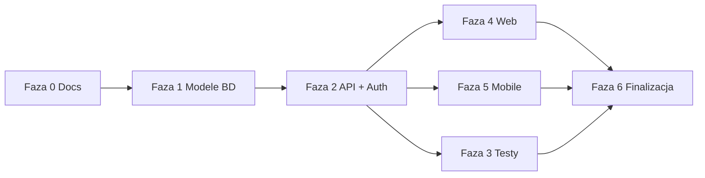

# Plan realizacji — PhysioCare

Plan dostosowany do wymagań prowadzącego i specyfiki projektu (web + mobile + backend w jednym repozytorium).

## Struktura monorepo

```
PhysioCare/
├── backend/          # Django + DRF
├── web/              # React (panel fizjoterapeuty)
├── mobile/           # React Native / Expo (pacjent)
├── database/         # schema.sql — referencja schematu PostgreSQL
├── docs/             # dokumentacja, diagramy, API
├── .env.example
└── README.md
```

Współpraca komponentów: **web** i **mobile** korzystają z tego samego **REST API** (`backend/`). Role JWT decydują o dostępie do endpointów.

---

## Fazy i kamienie milowe

### Faza 0 — Fundament repozytorium (tydzień 1)

| # | Zadanie | Deliverable |
|---|---------|-------------|
| 0.1 | Repozytorium Git + `.gitignore` | Repo na GitHub |
| 0.2 | Dokument wyboru tematu | `docs/topic-selection.md` |
| 0.3 | Diagram ERD | `docs/diagrams/erd.drawio` |
| 0.4 | Use case + architektura | `docs/use-cases.md`, `docs/diagrams/*.drawio` |
| 0.5 | README + `.env.example` | Instrukcja uruchomienia (szkielet) |
| 0.6 | **Commit inicjalizacyjny** | Tylko docs + struktura katalogów |

> Uwaga prowadzącego: zmiany kodu po utworzeniu Kamieni Milowych — ustal z prowadzącym moment startu implementacji.

---

### Faza 1 — Backend: szkielet i baza (tydzień 2–3)

| # | Zadanie | Deliverable |
|---|---------|-------------|
| 1.1 | Konfiguracja Django, PostgreSQL, Docker Compose (opcjonalnie) | `backend/` uruchamia się lokalnie |
| 1.2 | Modele: User, PatientProfile, TherapistProfile | Migracje |
| 1.3 | Modele: TreatmentEpisode, Visit, TherapyType | Migracje |
| 1.4 | Modele: BodyAreaPain, VisitNote, MedicalDocument | Migracje |
| 1.5 | Modele: Exercise, Assignment, Completion, Consent | Migracje |
| 1.6 | `database/schema.sql` zsynchronizowany z migracjami | Plik referencyjny |

---

### Faza 2 — API i autoryzacja (tydzień 4–5)

| # | Zadanie | Deliverable |
|---|---------|-------------|
| 2.1 | Rejestracja / logowanie pacjenta i terapeuty | Endpointy auth |
| 2.2 | JWT access + refresh, middleware ról | Chronione trasy |
| 2.3 | CRUD pacjenci, epizody, wizyty | REST z kodami HTTP |
| 2.4 | CRUD ćwiczenia, przypisania, compliance | REST |
| 2.5 | Upload/pobieranie plików (PDF, mp4) | Storage + limity |
| 2.6 | Dokumentacja API | `docs/api.md` + `docs/postman/` + `docs/postman-testing.md` |

---

### Faza 3 — Testy backendu (tydzień 5)

| # | Zadanie | Deliverable |
|---|---------|-------------|
| 3.1 | Testy auth (min. 2) | pytest |
| 3.2 | Testy wizyt i epizodów (min. 2) | pytest |
| 3.3 | Testy ćwiczeń/compliance (min. 1) | pytest |
| 3.4 | **Łącznie min. 5 testów** | CI lokalny / GitHub Actions |

---

### Faza 4 — Aplikacja webowa (tydzień 6–8)

| # | Zadanie | Deliverable |
|---|---------|-------------|
| 4.1 | Szkielet Vite + React + routing + apiClient | `web/` |
| 4.2 | Auth: login, rejestracja PWZFz, reset hasła | Widoki |
| 4.3 | Pulpit + harmonogram (kalendarz, D&D) | Widoki |
| 4.4 | Karta pacjenta + Diagnostic Mapper | Widoki |
| 4.5 | Baza ćwiczeń + przypisywanie | Widoki |
| 4.6 | Profil terapeuty | Widoki |
| 4.7 | Integracja z API (loading / error / empty) | Wszystkie moduły ✓ |

> **Status Faza 4:** zamknięta na branchu `feat/web` (web panel terapeuty).

---

### Faza 5 — Aplikacja mobilna (tydzień 9–11)

| # | Zadanie | Deliverable |
|---|---------|-------------|
| 5.1 | Szkielet Expo + nawigacja (tabs + stack) | `mobile/` |
| 5.2 | Auth + zgody RODO przy rejestracji | Ekrany |
| 5.3 | Pulpit + compliance ćwiczeń | Ekrany |
| 5.4 | Wizyty (nadchodzące / archiwum) | Ekrany |
| 5.5 | Profil, dokumenty, powiadomienia, zgody | Ekrany |
| 5.6 | Pod-widoki: szczegóły wizyty, profil terapeuty | Stack |
| 5.7 | Integracja z API | Pełny flow pacjenta |

---

### Faza 6 — Jakość, monitoring, finalizacja (tydzień 12–14)

| # | Zadanie | Deliverable |
|---|---------|-------------|
| 6.1 | Refaktoryzacja, ESLint, Prettier, Ruff | Czysty kod |
| 6.2 | Logowanie błędów serwera (strukturalne logi) | `docs/monitoring.md` |
| 6.3 | Metryki czasu odpowiedzi (middleware) | Podstawowy monitoring |
| 6.4 | Testy E2E krytycznych ścieżek | Checklist |
| 6.5 | Wdrożenie (np. Railway / VPS + Expo EAS) | Demo |
| 6.6 | Aktualizacja README, screenshoty | Dokumentacja finalna |
| 6.7 | Prezentacja pracy | Slajdy + demo live |

---

## Mapowanie na plan prowadzącego (21 punktów)

| Prowadzący | PhysioCare |
|------------|------------|
| 1. Repozytorium | Faza 0.1 |
| 2. Dokument tematu | Faza 0.2 |
| 3. Środowisko dev | Faza 1.1 + README |
| 4. README | Faza 0.5, aktualizacja Faza 6.6 |
| 5. ERD | Faza 0.3 |
| 6. Use case | Faza 0.4 |
| 7. Logika biznesowa | Faza 1–2 (serwisy Django) |
| 8. REST API | Faza 2 |
| 9. Integracja BD | Faza 1 |
| 10. Auth | Faza 2.1–2.2 |
| 11. Testy endpointów | Faza 3 + `docs/api.md` |
| 12. UI / makiety | Mockup + Faza 4–5 |
| 13. Widoki | Faza 4 + 5 |
| 14. Integracja frontend–API | Faza 4.7 + 5.7 |
| 15. Min. 5 testów | Faza 3 |
| 16. Refaktoryzacja | Faza 6.1 |
| 17–18. Monitoring i logi | Faza 6.2–6.3 |
| 19. Wersja finalna E2E | Faza 6.4 |
| 20. Dokumentacja | Faza 6.6 |
| 21. Prezentacja | Faza 6.7 |

---

## Kolejność implementacji (zalecana)



**Zasada:** backend i kontrakt API przed równoległą pracą nad web i mobile — oba klienty korzystają z tych samych endpointów i typów odpowiedzi.

---

## Następny krok (po commicie inicjalizacyjnym)

1. `django-admin startproject` w `backend/`
2. Docker Compose z PostgreSQL
3. Pierwsza migracja: `accounts` (User + profile)
4. Endpoint `POST /api/auth/register/patient` i `/therapist` jako proof-of-life API
