# Przegląd funkcjonalności i interfejsu - PhysioCare

Niniejszy dokument przedstawia architekturę interfejsu graficznego oraz kluczowe funkcjonalności platformy **PhysioCare** (panel webowy dla personelu medycznego i administracji oraz aplikacja mobilna dla pacjenta), zilustrowane zrzutami ekranu z działającego systemu.

---

## 1. Panel Administratora (Web)

Panel administracyjny (`/admin`) służy do nadzoru operacyjnego, analizy wskaźników kliniki, weryfikacji uprawnień zawodowych personelu oraz moderacji treści.

### 1.1. Pulpit analityczny KPI (`/admin`)
Główny pulpit zarządczy prezentuje zagregowane metryki operacyjne placówki:
* **Statystyki bazy użytkowników:** podział na pacjentów mobilnych, fizjoterapeutów oraz kadrę zarządzającą.
* **Wskaźnik frekwencji (Show-up Rate):** procentowy udział zrealizowanych wizyt względem odwołanych i niestawiennictw (no-show).
* **Średnia ocen kliniki:** zagregowana ocena jakości usług wystawiana przez pacjentów.
* **Baza terapeutyczna:** liczba aktywnych zestawów ćwiczeń i szablonów rehabilitacyjnych.

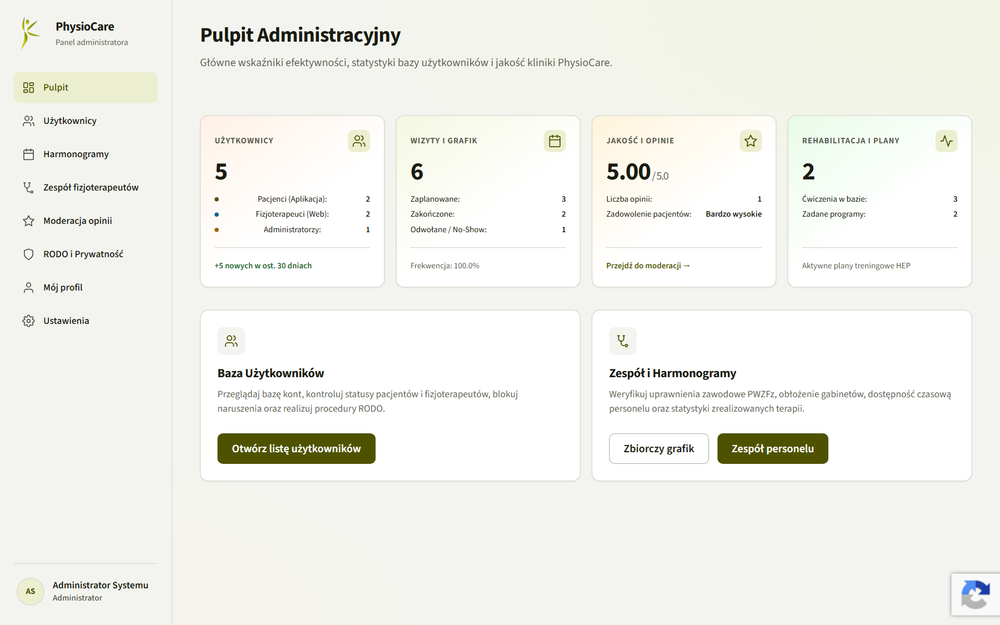

---

### 1.2. Zarządzanie użytkownikami i uprawnieniami (`/admin/users`)
Centralna kartoteka kont użytkowników platformy:
* **Filtrowanie i wyszukiwanie:** przeszukiwanie po nazwisku, adresie e-mail oraz rolach systemowych (`PATIENT`, `THERAPIST`, `ADMIN`).
* **Zarządzanie statusem konta:** możliwość natychmiastowej blokady (deaktywacji) profilu naruszającego regulamin wraz z unieważnieniem sesji (JWT blacklist).
* **Procedury RODO:** realizacja prawa do bycia zapomnianym (soft-delete z zachowaniem integralności dokumentacji medycznej).

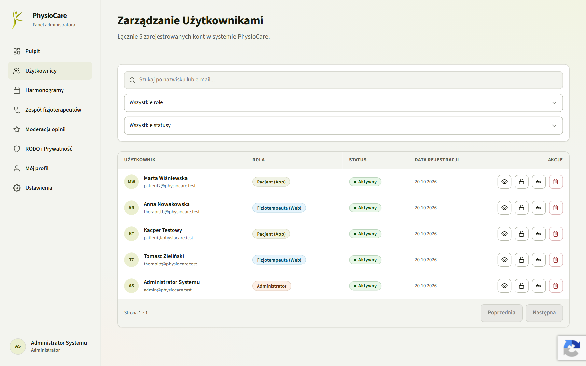

---

### 1.3. Zbiorczy harmonogram kliniki (`/admin/schedules`)
Wielostanowiskowa koordynacja obłożenia gabinetów:
* **Karty wskaźników operacyjnych:** bieżące podsumowanie liczby wizyt zaplanowanych, zrealizowanych, odwołanych i no-show.
* **Tabela wizyt w klinice:** przejrzysty wykaz rezerwacji pacjentów (np. Kacper Testowy, Marta Wiśniewska) z podziałem na przypisanych terapeutów, daty, godziny oraz statusy.
* **Szybkie filtrowanie:** sortowanie wg specjalisty, dnia i statusu realizacji świadczenia.

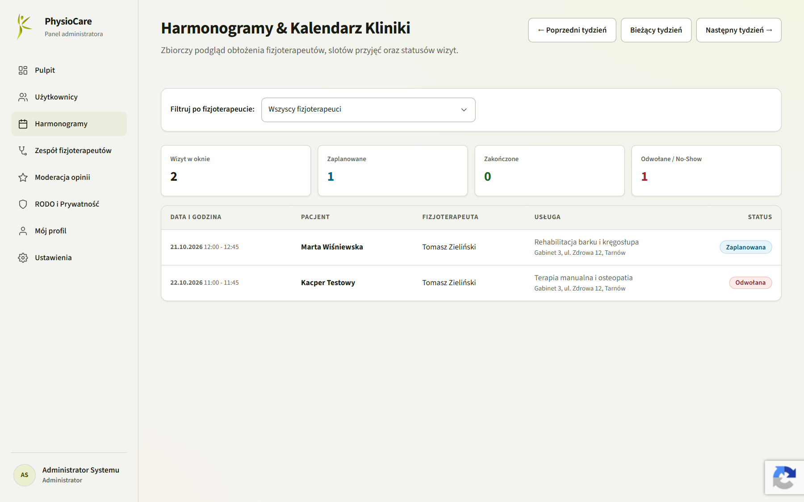

---

### 1.4. Zespół fizjoterapeutów i weryfikacja PWZFz (`/admin/therapists`)
Moduł weryfikacji personelu medycznego kliniki:
* **Kontrola uprawnień zawodowych:** weryfikacja 5-cyfrowego numeru Prawa Wykonywania Zawodu Fizjoterapeuty (KIF).
* **Poziom kwalifikacji i staż:** ewidencja stopnia zawodowego (Licencjat / Magister / Specjalista) oraz lat doświadczenia.
* **Wskaźniki jakościowe:** indywidualna średnia ocen i liczba opinii pacjentów dla każdego specjalisty.

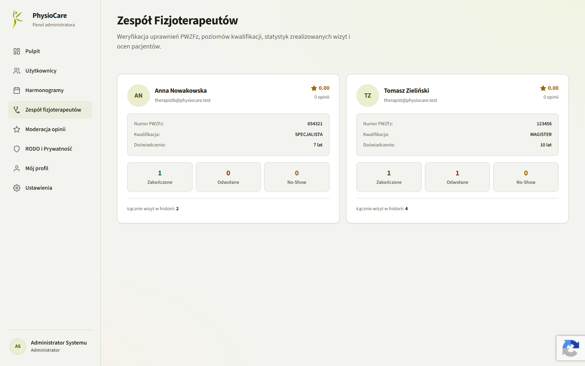

---

### 1.5. Moderacja opinii pacjentów (`/admin/reviews`)
Zarządzanie wizerunkiem i standardami komunikacji:
* **Przegląd recenzji:** wgląd w oceny punktowe (skala 1–5), treść komentarzy pacjentów oraz odpowiedzi personelu.
* **Przełącznik widoczności:** natychmiastowe ukrywanie wpisów niecenzuralnych lub naruszających regulamin.
* **Transakcyjna rekalkulacja:** automatyczne przeliczenie średniej ocen fizjoterapeuty po zmianie statusu publikacji.

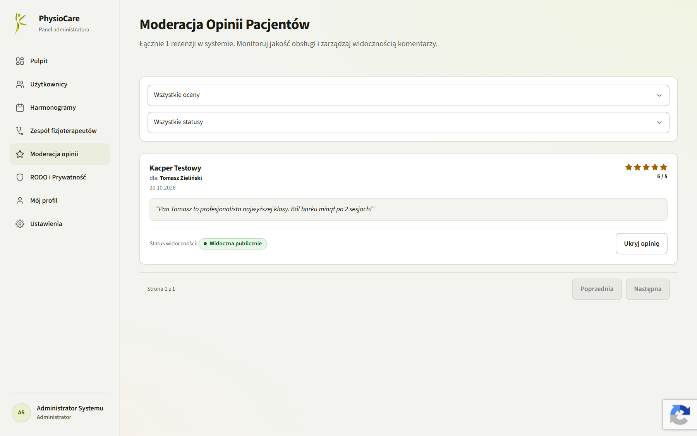

---

## 2. Panel Fizjoterapeuty (Web)

Panel kliniczny fizjoterapeuty wspiera codzienną pracę gabinetu: prowadzenie dokumentacji medycznej, diagnostykę bólu, planowanie wizyt oraz zadawanie ćwiczeń domowych.

### 2.1. Pulpit kliniczny fizjoterapeuty (`/`)
Centrum dowodzenia specjalisty po zalogowaniu do systemu:
* **Dzisiejszy harmonogram:** lista najbliższych pacjentów i zaplanowanych godzin przyjęć.
* **Szybkie akcje:** bezpośrednie przejście do karty pacjenta, rozpoczęcia wizyty lub dodania notatki.
* **Podsumowanie aktywności:** liczba prowadzonych epizodów leczenia oraz przypisanych planów rehabilitacji.

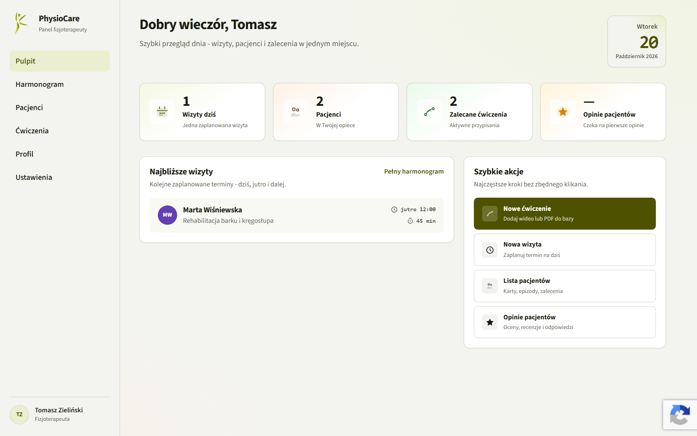

---

### 2.2. Harmonogram pracy i zarządzanie dostępnością (`/schedule`)
Zarządzanie grafikiem przyjęć w gabinecie:
* **Kalendarz wizyt:** interaktywny kalendarz z podziałem godzinowym i kolorystycznym wyróżnieniem typów terapii i pacjentów.
* **Sloty dostępności:** definiowanie cyklicznych godzin pracy (np. wybrane dni tygodnia) oraz slotów jednorazowych.
* **Zapobieganie kolizjom:** baza PostgreSQL weryfikuje nakładanie się przedziałów czasowych (`ExclusionConstraint` z typem `TSTZRANGE`).

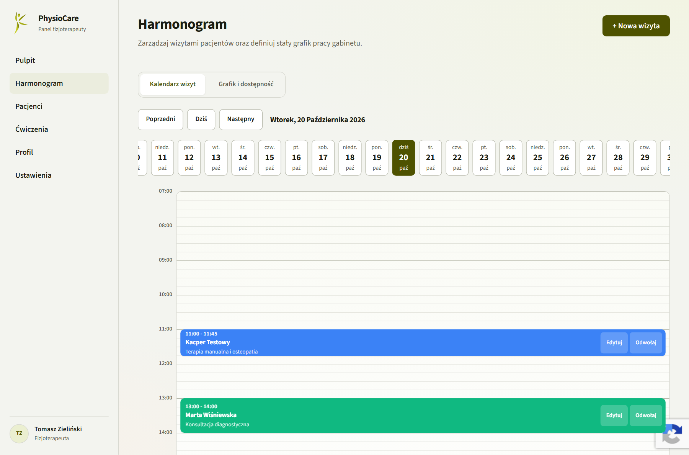

---

### 2.3. Baza pacjentów (`/patients`)
Lista podopiecznych objętych opieką fizjoterapeutyczną:
* **Wyszukiwarka pacjentów:** filtrowanie po imieniu, nazwisku i numerze telefonu.
* **Relacje N:M:** obsługa modelu wielogabinetowego: pacjent może być powiązany z kilkoma specjalistami jednocześnie (`PatientTherapistLink`).

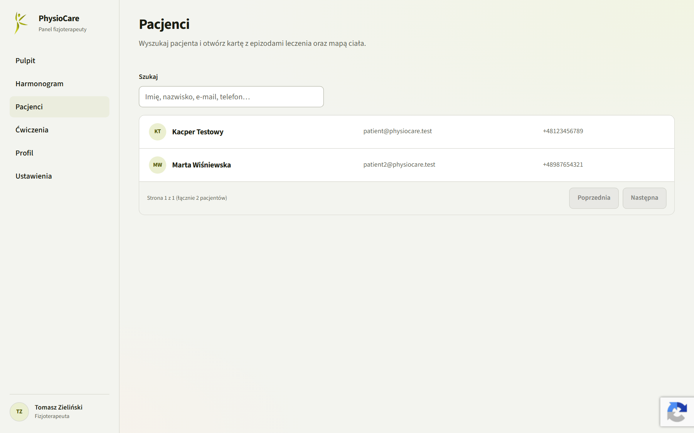

---

### 2.4. Karta pacjenta i zalecenia terapeutyczne (`/patients/:id`)
Elektroniczna Dokumentacja Medyczna (EDM):
* **Epizody leczenia:** grupowanie terapii wg jednostki chorobowej z przypisaniem kodu ICD-10 (np. M75.1).
* **Zalecenia ćwiczeń:** lista aktywnych zestawów rehabilitacyjnych przypisanych pacjentowi wraz z dawkami i terminem realizacji.
* **Szyfrowanie danych wrażliwych (At-Rest):** diagnoza funkcjonalna, wywiad oraz notatki kliniczne są automatycznie szyfrowane w PostgreSQL algorytmem Fernet (AES-128-CBC + HMAC SHA-256).

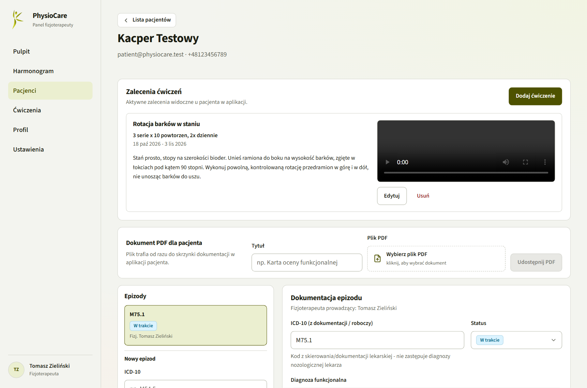

---

### 2.5. Interaktywna mapa ciała DiagnosticMapper (`/patients/:id`)
Diagnostyka dolegliwości bólowych i lokalizacja struktur anatomicznych:
* **Model wektorowy sylwetki:** interaktywna mapa człowieka w widoku przednim i tylnym (`front` / `back`).
* **Punktacja skali bólu VAS (0–10):** kolorystyczne oznaczanie intensywności dolegliwości w wybranych partiach mięśniowych i stawowych.
* **Grupowanie struktur:** klasyfikacja dotkniętych tkanek (staw, mięsień, kość, tkanka miękka) oraz charakteru bólu (kłujący, tępy, pulsujący).
* **Notatki z badania:** dokumentacja palpacyjna i funkcjonalna skorelowana z mapą.

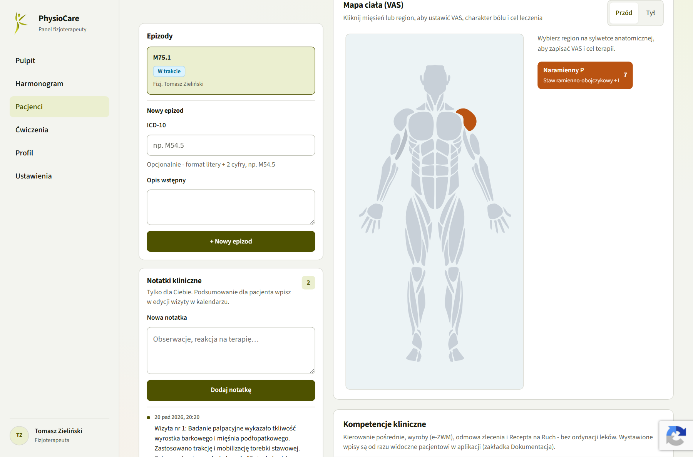

---

### 2.6. Katalog ćwiczeń rehabilitacyjnych z wideo (`/exercises`)
Baza wiedzy i instruktaży multimedialnych:
* **Odtwarzacz instruktażowy wideo:** wbudowany player HTML5 prezentujący prawidłowy wzorzec ruchowy ćwiczenia (np. *Rotacja barków w staniu*).
* **Kategoryzacja i tagi:** podział wg obszaru ciała (barki, kręgosłup, biodra), trudności i celu terapeutycznego.
* **Dawkowanie:** definiowanie serii, powtórzeń i przerw między seriami.

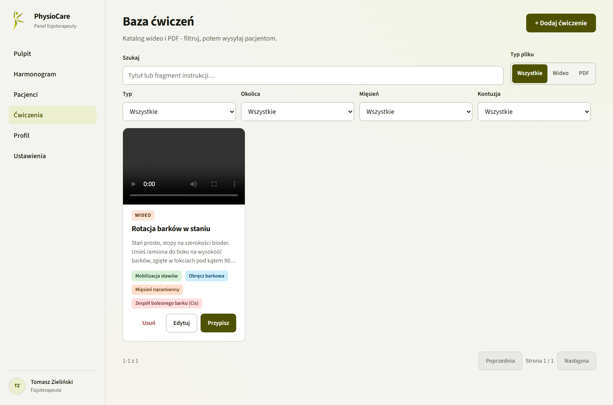

---

### 2.7. Profil zawodowy fizjoterapeuty (`/profile`)
Wizytówka specjalisty widoczna w systemie rezerwacji pacjentów:
* **Dane formalne:** numer PWZFz, poziom wykształcenia i lata stażu klinicznego.
* **Biogram i certyfikaty:** dynamiczna lista ukończonych kursów i specjalizacji podyplomowych.

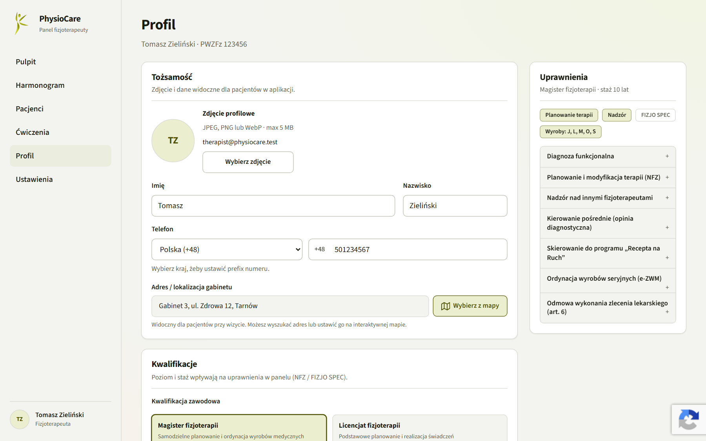

---

## 3. Strefa Pacjenta (Web & Mobile)

PhysioCare oferuje pacjentowi dwa kanały dostępu: portal informacyjny w przeglądarce oraz natywną aplikację mobilną na smartfony z systemem Android.

### 3.1. Webowy portal pacjenta (`/patient-portal`)
Dedykowana przestrzeń dla pacjentów logujących się przez przeglądarkę:
* **Pulpit informacyjny:** spersonalizowane powitanie, skrót do zaleceń oraz kontakt z gabinetem.
* **Dystrybucja aplikacji mobilnej:** bezpośredni odnośnik do pobrania najnowszej paczki APK (Expo EAS Distribution) na smartfon pacjenta.

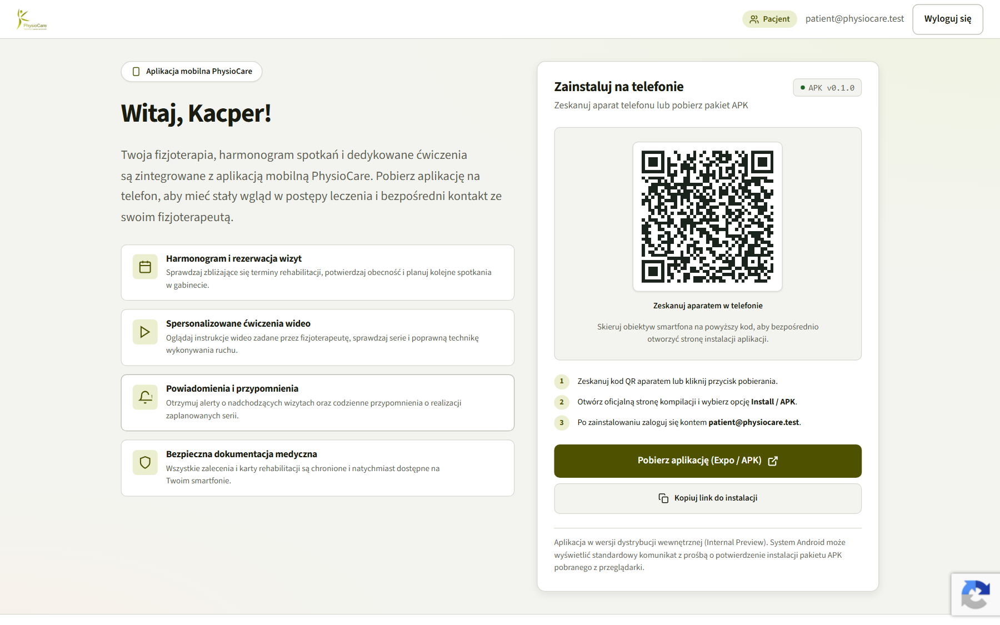

---

### 3.2. Aplikacja Mobilna Pacjenta (React Native / Expo)
Natywna aplikacja na smartfony (zrzuty wykonane bezpośrednio w środowisku emulatora Pixel 8 z systemem Android):

#### 3.2.1. Pulpit główny i realizacja zaleceń
* **Postęp planu rehabilitacji:** wskaźnik compliance, liczba wykonanych sesji oraz bezpośrednia lista ćwiczeń na bieżący dzień.
* **Szybkie oznaczenie wykonania:** możliwość raportowania zakończenia serii i subiektywnej oceny trudności.

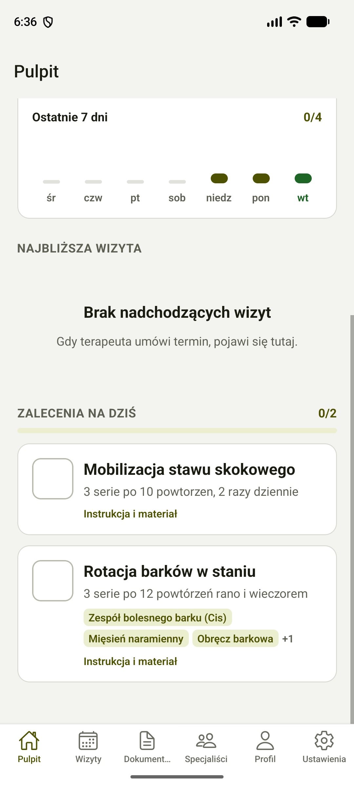

#### 3.2.2. Instruktaż wideo ćwiczenia
* **Natywny odtwarzacz wideo:** odtwarzanie pełnego instruktażu ruchowego wideo (np. *Rotacja barków w staniu*) z kontrolkami pauzy, przewijania i pełnego ekranu.
* **Wskazówki wykonawcze:** liczba serii, powtórzeń, czas odpoczynku oraz opis techniki oddychania i stabilizacji.

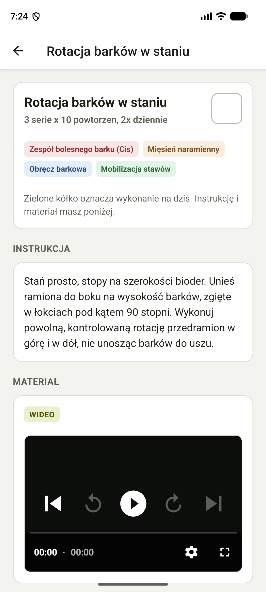

#### 3.2.3. Terminarz i rezerwacja wizyt
* **Kalendarz pacjenta:** podgląd nadchodzących i historycznych wizyt w gabinecie wraz z przypisanym fizjoterapeutą i gabinetem.
* **Umawianie wizyt:** wybór dogodnego slotu czasowego zintegrowany z silnikiem rezerwacji backendu.

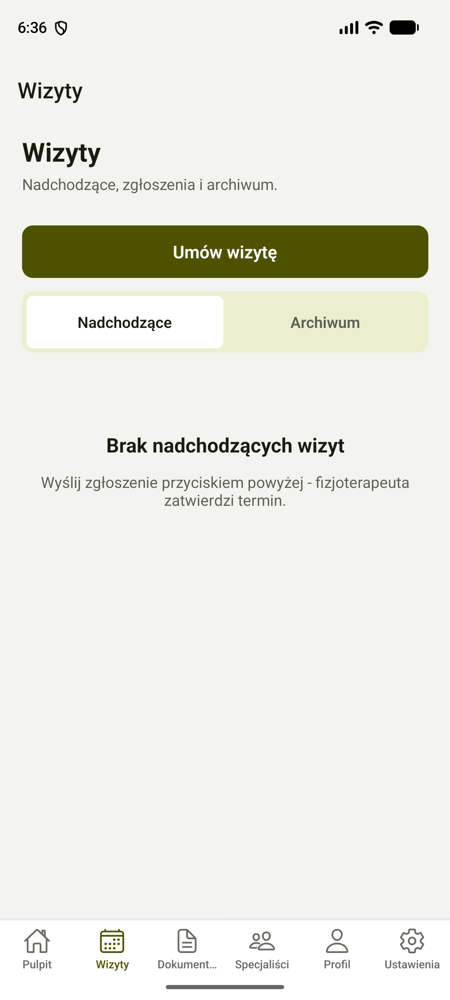

#### 3.2.4. Dokumentacja medyczna pacjenta
* **Dostęp do zaleceń:** zbiór zaleceń po wizycie, skierowań, wniosków e-ZWM oraz kart informacyjnych.
* **Pobieranie plików:** bezpieczny podgląd i eksport dokumentów w formacie PDF.

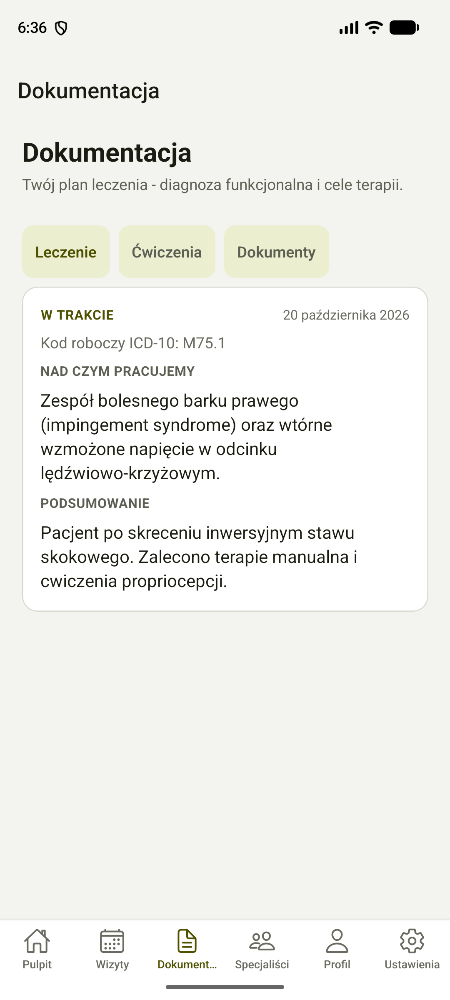

#### 3.2.5. Zespół fizjoterapeutów
* **Katalog specjalistów:** lista fizjoterapeutów placówki wraz z biogramami, numerami PWZFz oraz opiniami innych pacjentów.
* **Wyszukiwarka:** możliwość wyboru terapeuty wg specjalizacji (np. rehabilitacja ortopedyczna, sportowa).

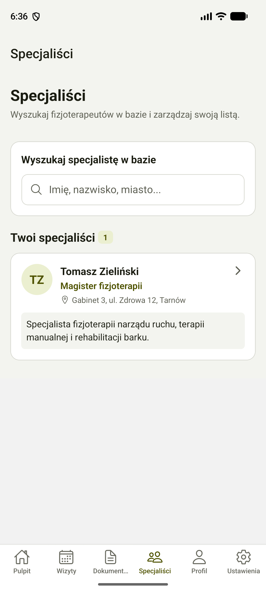

#### 3.2.6. Profil pacjenta i preferencje
* **Ustawienia konta:** dane kontaktowe, zarządzanie powiadomieniami push o ćwiczeniach i wizytach oraz bezpieczne wylogowanie.

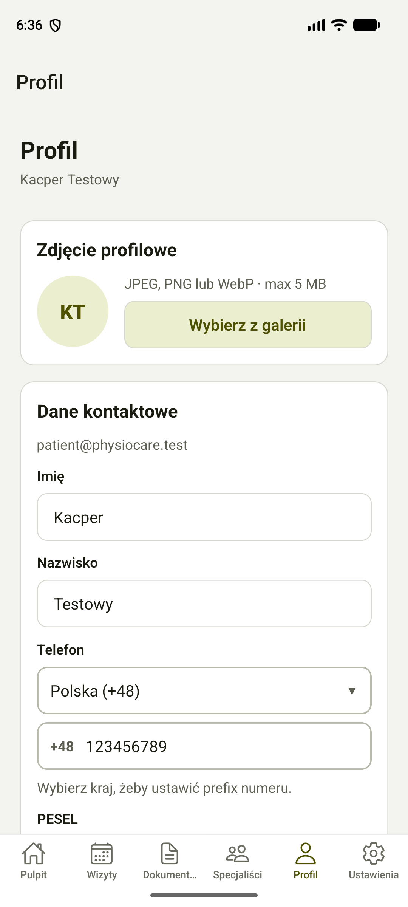

---

## 4. Bezpieczeństwo, Uwierzytelnianie i RODO

System został zaprojektowany z zachowaniem zasad Privacy by Design oraz rygorystycznych wymogów prawa medycznego.

### 4.1. Uwierzytelnianie i Role-Based Access Control (`/login`)
Bezpieczny punkt wejścia do aplikacji:
* **Uwierzytelnianie:** logowanie e-mail/hasło lub Google Sign-In z tokenami JWT (access token 15 min, refresh token 7 dni) przekazywanymi w ciasteczkach `HttpOnly`.
* **Rozdział uprawnień (RBAC):** automatyczne przekierowanie do dedykowanego panelu w zależności od roli (`ADMIN`, `THERAPIST`, `PATIENT`).

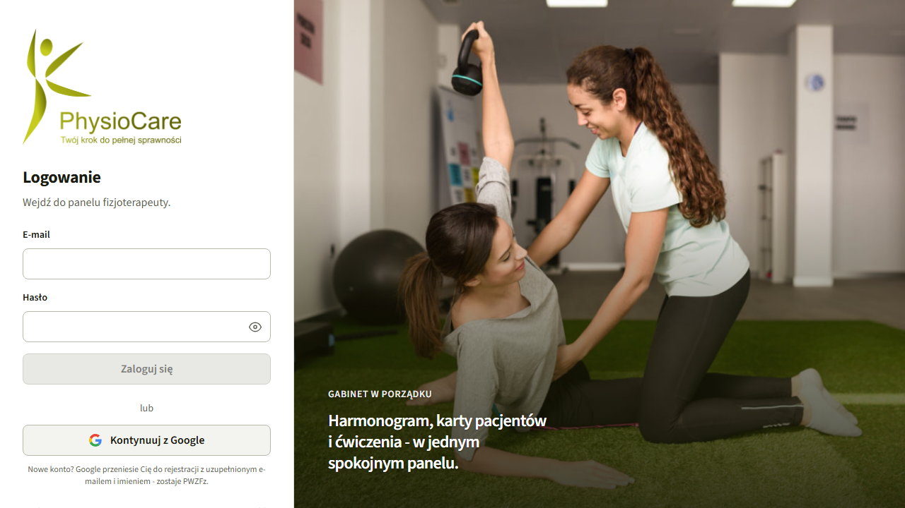

---

### 4.2. Rejestracja personelu z walidacją PWZFz (`/register`)
Formularz zakładania konta fizjoterapeuty:
* **Walidacja zawodowa:** weryfikacja poprawności formatu numeru PWZFz przed rejestracją.
* **Oświadczenie prawne:** obligatoryjna klauzula potwierdzająca prawo wykonywania zawodu.

---

### 4.3. Klauzula RODO i ochrona danych szczególnych kategorii (`/privacy`)
Ochrona prywatności pacjentów:
* **Zgody Art. 9 RODO:** jednoznaczna podstawa prawna na przetwarzanie danych o stanie zdrowia.
* **Zasada minimalizacji danych:** administratorzy systemu nie mają wglądu w zaszyfrowaną treść medyczną pacjentów.
* **Polityka retencji i anonimizacji:** wsparcie dla prawa do bycia zapomnianym z zachowaniem wymogów ustawowych przechowywania dokumentacji medycznej.

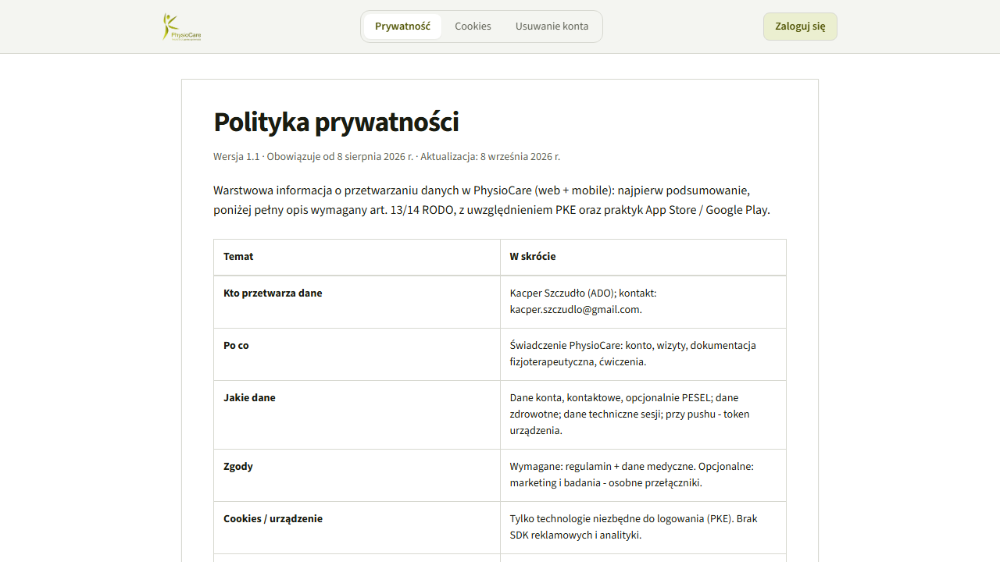
