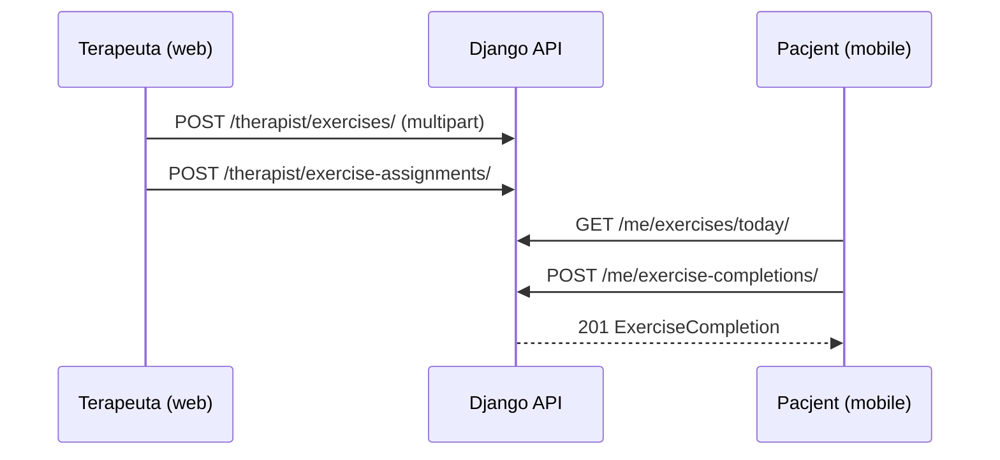

# Testowanie API w Postmanie - PhysioCare

> Specyfikacja kolekcji testowej REST API oraz macierzy przypadków użycia.
> Kolekcja: [`postman/PhysioCare.json`](postman/PhysioCare.json) · środowisko: [`postman/PhysioCare.postman_environment.json`](postman/PhysioCare.postman_environment.json)

Dokument łączy **zamysł projektu** (UC-01-UC-18) z **konkretnymi requestami** do uruchomienia na lokalnym backendzie. Celem jest sprawdzenie każdego happy pathu i typowych wyjątków zanim web/mobile zaczną konsumować API.

---

## 1. Co weryfikujemy

PhysioCare ma trzech aktorów i jeden centralny backend:

| Klient | Rola JWT | Główne UC |
|--------|----------|-----------|
| Mobile | `PATIENT` | UC-01-09, UC-17-18 |
| Web | `THERAPIST` | UC-01-04, UC-10-16, UC-19 |
| Web | `ADMIN` | UC-22-27 (Nadzór, analityka KPI, użytkownicy, moderacja) |

Każdy request w kolekcji ma skrypt testowy (status HTTP + często envelope błędu / zapis ID do zmiennych).

```mermaid
flowchart TB
  subgraph setup [00 Setup]
    T[Register therapist]
    L1[Login therapist]
    P[Register patient]
    L2[Login patient]
    A[Login admin]
    T --> L1 --> P --> L2 --> A
  end

  subgraph therapist [Ścieżka terapeuty]
    D[Dashboard]
    E[Epizody + mapa ciała]
    V[Harmonogram wizyt]
    X[Ćwiczenia + dokumenty]
    D --> E --> V --> X
  end

  subgraph patient [Ścieżka pacjenta]
    Me[Profil / zgody / powiadomienia]
    Vis[Wizyty me]
    Comp[Ćwiczenia dziś + completion]
    Docs[Dokumenty]
    Me --> Vis --> Comp --> Docs
  end

  subgraph admin [Ścieżka administratora]
    ADash[Admin Dashboard KPI]
    AUsers[Zarządzanie użytkownikami]
    ASched[Zbiorczy kalendarz kliniki]
    ATherap[Statystyki personelu]
    ARev[Moderacja opinii]
    ADash --> AUsers --> ASched --> ATherap --> ARev
  end

  setup --> therapist
  setup --> patient
  setup --> admin
```



---

## 2. Import i uruchomienie

### Wymagania

1. Backend działa na `http://localhost:8000` (patrz README).
2. Postman Desktop (zalecane) lub Cursor Postman plugin.
3. Włączony **Cookie Jar** - auth ustawia `access_token` / `refresh_token` jako cookies httpOnly; skrypty próbują też skopiować je do `{{access_token}}` (Bearer).

### Import

1. **Import** -> `docs/postman/PhysioCare.json`
2. **Import** -> `docs/postman/PhysioCare.postman_environment.json`
3. Wybierz environment **PhysioCare Local**
4. Collection Runner -> folder **`00 Setup - Auth & seed`** jako pierwszy

### Seed (kolejność krytyczna)

Rejestracja pacjenta wymaga `therapist_id` (UUID profilu terapeuty):

1. `POST /auth/register/therapist/`
2. `POST /auth/login/` (terapeuta)
3. `GET /therapist/profile/` -> zapis `therapist_profile_id`
4. `POST /auth/register/patient/` z `therapist_id`
5. Dalej foldery domenowe

Przy ponownym uruchomieniu na tej samej bazie zmień e-maile / `pwzf_number` w zmiennych albo wyczyść DB.

### Pliki (multipart)

Requesty uploadu (`exercises`, `documents`) mają pole `file` typu File - w Postmanie wskaż lokalny `.mp4` / `.pdf`. Bez pliku oczekiwany jest `400 FILE_REQUIRED`.

---

## 3. Auth - jak działa w praktyce

| Mechanizm | Zachowanie backendu |
|-----------|---------------------|
| Login / register | Ustawia cookies `access_token`, `refresh_token` |
| Chronione endpointy | `CookieJWTAuthentication` - cookie **lub** `Authorization: Bearer` |
| Refresh | Body `{ "refresh" }` **lub** cookie `refresh_token` |
| Błędy | `{ "error": { "code", "message", "details" } }` |

W kolekcji: auth na poziomie collection = Bearer `{{access_token}}`. Po loginie skrypt testowy uzupełnia zmienną z jar cookies (gdy Postman na to pozwala). Jeśli Bearer jest pusty, Cookie Jar i tak wyśle cookies na `localhost`.

---

## 4. Mockup przepływów (scenariusze E2E)

Poniżej „makiety” ścieżek API - to nie UI, tylko sekwencje requestów odpowiadające ekranom z use-case’ów.

### 4.1 Onboarding gabinetu (web)

```text
[Rejestracja terapeuty] --201--> cookies JWT
        |
        v
[Login] --200--> GET /therapist/profile
        |
        v
[Pulpit] GET /therapist/dashboard/stats
        |
        v
[Typ terapii] POST /therapist/therapy-types
        |
        v
(pacjent połączony relacją N:M po umówieniu wizyty lub dodaniu z bazy)
```

### 4.2 Pierwsza wizyta i dokumentacja (web)

```text
GET /patients/  -->  patient_profile_id
        |
        v
POST .../episodes/  -->  episode_id   (ICD-10, status)
        |
        |-- POST .../body-pain/     (mapa ciała VAS)
        |-- POST .../notes/         (notatka)
        `-- POST /therapist/visits/ (termin + therapy_type)
                    |
                    `-- overlap? --400-- „koliduje z inną wizytą”
```

### 4.3 Pacjent w aplikacji (mobile)

```text
Login patient
   |
   |-- GET /me/visits?status=upcoming     (UC-05 / UC-07)
   |-- GET /me/exercises/today            (UC-05 / UC-06)
   |       `-- POST /me/exercise-completions
   |-- GET /me/documents + download       (UC-08)
   |-- GET/PATCH /me/consents*            (UC-09)
   |-- GET /therapists/{id}/public        (UC-17)
   `-- GET/PATCH /me/notification-preferences  (UC-18)
   `-- POST/DELETE /me/device-tokens
```

### 4.4 Compliance ćwiczeń (web -> mobile)



---

## 5. Macierz UC × requesty × oczekiwane kody

| UC | Folder Postman | Happy path | Wyjątki w kolekcji |
|----|----------------|------------|--------------------|
| **UC-01** Logowanie | `00 Setup` | `POST /auth/login/` -> 200 | złe hasło -> **401** `AUTH_001` |
| **UC-02** Rej. pacjenta | `00 Setup` | `POST /auth/register/patient/` -> 201 | brak zgód -> **400**; e-mail zajęty -> **400/409** |
| **UC-03** Rej. terapeuty | `00 Setup` | `POST /auth/register/therapist/` -> 201 | brak PWZFz -> **400**; duplikat -> **400/409** |
| **UC-04** Reset hasła | `00 Setup` | `.../request/` -> 200 (anti-enum) | zły token confirm -> **400** `AUTH_002` |
| **UC-05** Pulpit pacjenta | `Exercises` + `Visits` | `GET /me/visits`, `GET /me/exercises/today` | - (dane z poprzednich kroków) |
| **UC-06** Compliance | `Exercises` | `POST /me/exercise-completions/` -> 201 | obce `assignment_id` -> **400** |
| **UC-07** Wizyty pacjenta | `Visits` | list / reschedule / cancel | overlap przy reschedule -> **400** |
| **UC-08** Dokumenty | `Documents` | list + download | brak pliku upload -> **400**; cudzy dostęp -> **404** |
| **UC-09** Zgody / RODO | `Patient me` | consents, export **200**, deletion **202** | brak tokena -> **401** |
| **UC-10** Pulpit terapeuty | `Dashboard` | `GET .../dashboard/stats` -> 200 | zła rola -> **401/403** |
| **UC-11** Harmonogram | `Visits` | day list, create, PATCH slot | kolizja terminu -> **400** |
| **UC-12** Karta / epizody | `Patients & episodes` | CRUD epizod + notatka | pacjent spoza gabinetu -> **404** |
| **UC-13** Mapa ciała | `Body map` | POST/GET/PUT body-pain | VAS > 10 -> **400** |
| **UC-14** Zarządzanie wizytą | `Visits` | PATCH visit, cancel | brak dostępu -> **404** |
| **UC-15** Ćwiczenia | `Exercises` | create + assign | brak pliku -> **400** |
| **UC-16** Profil terapeuty | `Therapist profile` | GET/PATCH `/therapist/profile/` | - |
| **UC-17** Wizytówka | `Therapist profile` | `GET /therapists/{id}/public/` | - |
| **UC-18** Powiadomienia | `Patient me` | GET/PATCH preferences, POST/DELETE device-tokens | wysyłka: push lub e-mail; przypomnienia: `run_notification_scheduler --once` |
| **Security** | `Security` | - | patient -> `/patients/` **403**; no token **401** |

Refresh token: `POST /auth/refresh/` -> 200 (w Setup).

---

## 6. Katalog folderów kolekcji

| # | Folder | Endpointy (skrót) |
|---|--------|-------------------|
| 00 | Setup - Auth & seed | register ×2, login, refresh, password-reset |
| 01 | UC-10 Dashboard | `/therapist/dashboard/stats/` |
| 02 | UC-12 Patients & episodes | `/patients/`, `/episodes/`, notes |
| 03 | UC-13 Body map | `/episodes/{id}/body-pain/` |
| 04 | UC-07/11/14 Visits | therapy-types, visits, me/visits, reschedule, cancel |
| 05 | UC-06/15 Exercises | exercises, assignments, today, completions |
| 06 | UC-08 Documents | upload, me/documents, `/{id}/download/` |
| 07 | UC-16/17 Profile | therapist profile + public |
| 08 | UC-05/09/18 Me & privacy | profile, consents, export, deletion, notifications |
| 09 | Security | role guards |

---

## 7. Zmienne

| Zmienna | Opis |
|---------|------|
| `baseUrl` | `http://localhost:8000/api/v1` |
| `therapist_email` / `patient_email` / `password` | Konta seed |
| `pwzf_number` | Numer PWZFz przy rejestracji terapeuty |
| `therapist_profile_id` | UUID z `GET /therapist/profile/` |
| `patient_profile_id` | UUID z listy pacjentów |
| `episode_id`, `visit_id`, `exercise_id`, `assignment_id`, `document_id`, `body_pain_id` | Ustawiane automatycznie przez test scripts |
| `visit_start` / `visit_end` / `schedule_date` | Terminy harmonogramu (ISO 8601) |
| `assignment_start` / `assignment_end` / `today` | Okres ćwiczeń i data completion |
| `access_token` / `refresh_token` | Synchronizowane po loginie |

Daty w zmiennych domyślnych są ustawione na sierpień 2026 - dostosuj do „dziś”, żeby `GET /me/exercises/today` i `upcoming` zwracały dane.

---

## 8. Checklist „wszystkie przypadki”

Uruchom Collection Runner (kolejność folderów) i odhacz:

### Auth

- [ ] Rejestracja terapeuty 201
- [ ] Rejestracja bez deklaracji PWZFz 400
- [ ] Duplikat terapeuty 400/409
- [ ] Login terapeuty 200 + cookies
- [ ] Rejestracja pacjenta ze zgodami 201
- [ ] Rejestracja bez `terms` 400
- [ ] Duplikat e-mail pacjenta 400/409
- [ ] Login pacjenta 200
- [ ] Złe hasło 401
- [ ] Refresh 200
- [ ] Reset request 200 (nawet dla nieistniejącego maila)
- [ ] Reset confirm ze złym tokenem 400

### Terapeuta

- [ ] Stats pulpitu 200
- [ ] Lista / detail pacjenta
- [ ] Nowy epizod + patch + notatka
- [ ] Body-pain create / update; VAS 15 -> 400
- [ ] Katalog wyrobów medycznych (UC-19) – filtrowanie wg uprawnień PWZFz
- [ ] Typ terapii + wizyta 201
- [ ] Druga wizyta w tym samym slocie -> 400 overlap
- [ ] Harmonogram dnia, PATCH slotu
- [ ] Upload ćwiczenia (z plikiem) + assignment
- [ ] Upload dokumentu PDF
- [ ] PATCH profilu (bio, courses)

### Pacjent

- [ ] `me/visits` upcoming / past
- [ ] Reschedule + cancel
- [ ] `me/exercises/today` + completion 201
- [ ] Completion obcego assignment -> 400
- [ ] Skrzynka dokumentów klinicznych (UC-08) – zlecenia wyrobów e-ZWM / Recepta na Ruch / odmowy
- [ ] `me/documents` + download
- [ ] Profil, zgody opcjonalne, eksport, usunięcie konta RODO (UC-20) 202
- [ ] Strumieniowanie zdarzeń SSE (`/api/v1/me/events/`)
- [ ] Preferencje powiadomień
- [ ] Publiczny profil terapeuty
- [ ] Request bez auth -> 401

### Administrator (UC-22 - UC-27)

- [ ] Dashboard KPI `/admin/dashboard/` -> 200
- [ ] Paginowana lista kont `/admin/users/` (wyszukiwanie + filtry) -> 200
- [ ] Szczegóły profilu użytkownika `/admin/users/{id}/` -> 200
- [ ] Zmiana statusu konta (blokada/odblokowanie) `/admin/users/{id}/status/` -> 200
- [ ] Inicjalizacja resetu hasła `/admin/users/{id}/reset-password/` -> 200
- [ ] Bezpieczna dezaktywacja RODO (soft delete) DELETE `/admin/users/{id}/` -> 200
- [ ] Blokada samodezaktywacji admina -> 403
- [ ] Wielostanowiskowy grafik `/admin/schedules/overview/` -> 200
- [ ] Efektywność personelu `/admin/therapists/stats/` -> 200
- [ ] Moderacja recenzji `/admin/reviews/` -> 200
- [ ] Ukrycie / przywrócenie opinii `/admin/reviews/{id}/visibility/` -> 200

### Role & Strażnicy Dostępności (RBAC / BFLA)

- [ ] Pacjent nie listuje `/patients/` (403)
- [ ] Pacjent nie czyta dashboardu terapeuty (403)
- [ ] Pacjent nie ma dostępu do panelu administratora `/admin/*` (403)
- [ ] Fizjoterapeuta nie ma dostępu do panelu administratora `/admin/*` (403)
- [ ] Zapytanie bez tokenu do `/admin/*` -> 401

---

## 8.1 Szybka weryfikacja z terminala (`scripts/run_postman.py`)

Do automatycznego sprawdzenia pliku kolekcji Postman lub uruchomienia jej przez runner CLI (Newman):

```powershell
python scripts/run_postman.py
```

---

## 9. Aktualizacja kolekcji

Kolekcja w `docs/postman/` jest artefaktem w repo - edytuj ją w Postmanie (Export -> nadpisz JSON) albo ręcznie, gdy zmienia się kontrakt API.

---

## 10. Powiązane dokumenty

| Dokument | Rola |
|----------|------|
| [use-cases.md](use-cases.md) | Specyfikacja UC (aktorzy, wyjątki) |
| [api.md](api.md) | Kontrakt REST (body, kody) |
| [architecture.md](architecture.md) | Moduły Django, przepływy |

---

## 11. Uwagi implementacyjne (stan backendu)

1. **Tokeny nie wracają w JSON body** - tylko cookies (+ opcjonalnie Bearer jeśli klient je ustawi).
2. **Download dokumentu:** `GET /api/v1/{document_id}/download/` (bez segmentu `documents/` - tak jest w `documents/urls.py`).
3. **Rejestracja pacjenta** wymaga `therapist_id` (pole obowiązkowe w serializerze) - różnica względem starszego szkicu w `api.md` (bez terapeuty).
4. Rate limiting: login / register / password-reset mają throttle - przy agresywnym Runnerze możesz dostać **429**.
